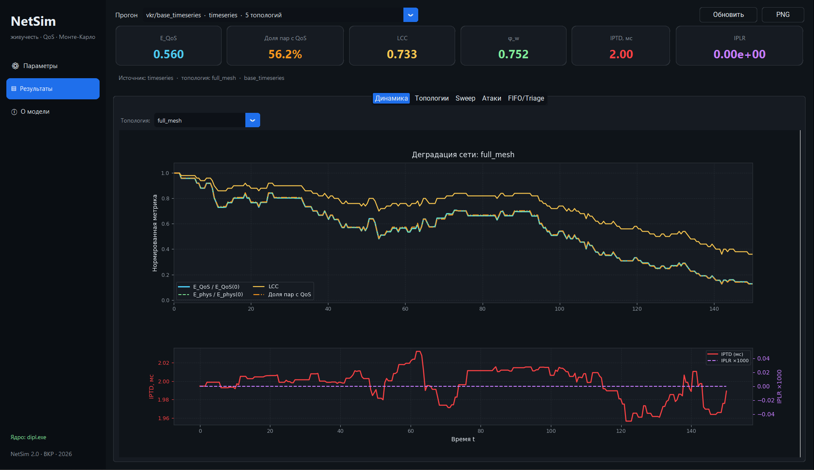
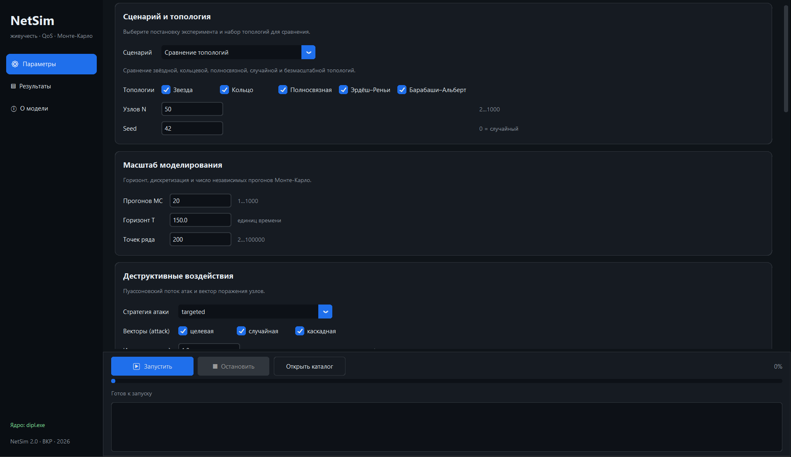
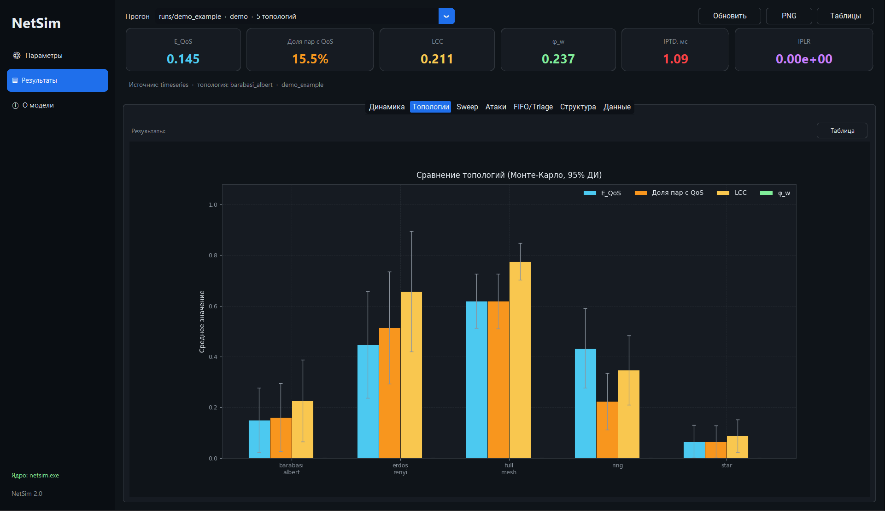
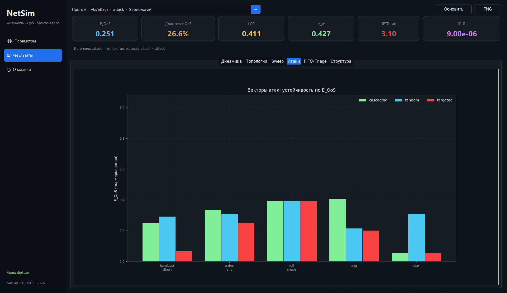
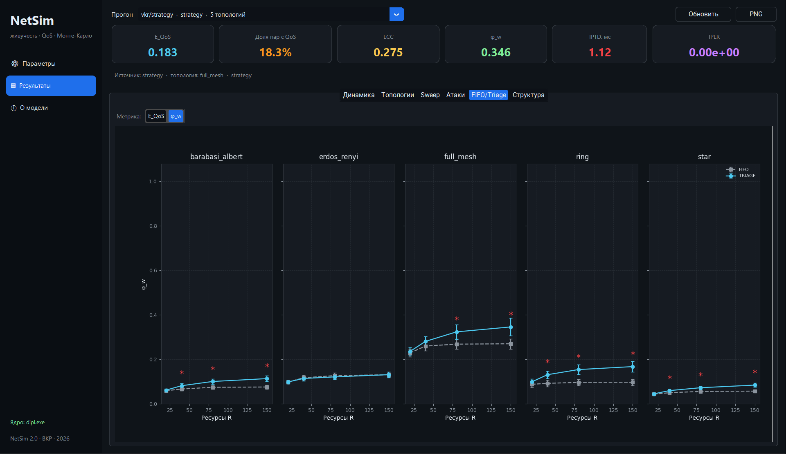
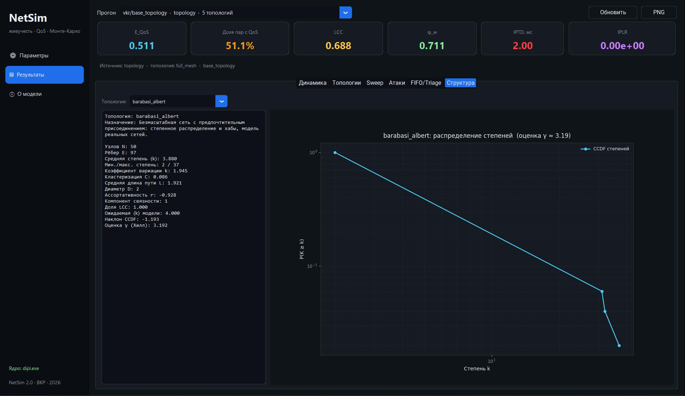

# NetSim — оценка живучести и QoS информационной инфраструктуры

Программный комплекс для имитационного моделирования функциональной
устойчивости гетерогенных информационных инфраструктур с учётом требований
качества обслуживания IP-сетей (МСЭ-Т Y.1541). Развитие научно-исследовательской
работы: добавлены физическая модель каналов M/M/1, QoS-эффективность,
дискретно-событийное ядро и графический интерфейс.



## Возможности

- **Y.1541**: классы QoS 0–7, пороги IPTD / IPDV / IPLR / IPER, проверка путей.
- **M/M/1(K)**: пересчёт пропускной способности и загрузки канала в задержку,
  вероятность потери и IPDV.
- **QoS-эффективность** `E_QoS` — нормированная глобальная эффективность,
  в которой учитываются только пары, прошедшие проверку класса QoS.
- **Направленный граф**: пропускная способность, базовая задержка и текущая
  загрузка каждой дуги.
- **Топологии**: звезда, кольцо, полносвязная, Эрдёша–Реньи, Барабаши–Альберта.
- **Структурный анализ ER/BA**: степени, CCDF, оценка γ, кластеризация,
  средняя длина пути, диаметр, ассортативность, компоненты.
- **Трафик All-to-All** с итеративным распределением (Дейкстра + MSA) и
  моделированием заторов при отказах.
- **Дискретно-событийное ядро**: пуассоновские атаки, бригады восстановления,
  FIFO / Triage, стоимость и вероятность ремонта.
- **Монте-Карло**: доверительные интервалы Стьюдента, U-критерий Манна–Уитни,
  поправка Холма.
- **GUI на CustomTkinter**: формы параметров, запуск ядра, графики Matplotlib,
  экспорт PNG, журнал выполнения.
- **CSV-отчёты** по всем сценариям и автономный `plot_results.py`.

## Быстрый старт

### 1. Сборка C++-ядра

Требуется Visual Studio 2022/2026 с компонентом «Разработка классических
приложений на C++».

```powershell
.\build.ps1
# или
msbuild dipl.vcxproj /p:Configuration=Release /p:Platform=x64
```

Результат: `x64\Release\dipl.exe`.

### 2. Запуск GUI

```powershell
python -m pip install customtkinter matplotlib pandas
python run_gui.py
```

GUI сам находит `x64\Release\dipl.exe`. Если ядро лежит в другом месте,
задайте переменную `NETSIM_EXE`.

### 3. Пакетный запуск

```powershell
.\x64\Release\dipl.exe run --scenario topology `
    --num-nodes 50 --sims 30 --T 150 `
    --lambda 1.0 --resources 200 --slots 3 `
    --qos-class 1 --out results\run1 --progress
```

Построение графиков по готовому прогону:

```powershell
python plot_results.py results\run1
```

## Сценарии

| Сценарий | Назначение |
|---|---|
| `topology` | сравнение топологий по E_QoS, LCC, φ_w, IPTD, IPLR |
| `sweep` | однофакторный анализ по λ, R, μ, P_attack |
| `strategy` | FIFO vs Triage при разных уровнях ресурсов |
| `attack` | целевые, случайные и каскадные атаки |
| `timeseries` | временные ряды одной реализации |
| `structure` | только структурный анализ ER/BA (без симуляции) |
| `all` | последовательный запуск всех сценариев |

## Структура проекта

```
├── topology.h/.cpp      направленный граф и генераторы топологий
├── topology_metrics.h/.cpp  структурный анализ ER/BA
├── qos.h/.cpp           классы Y.1541, M/M/1(K), проверка путей
├── traffic.h/.cpp       All-to-All, Дейкстра, MSA, матрица путей
├── metrics.h/.cpp       E_phys, E_QoS, LCC, φ_w, IPTD/IPLR
├── engine.h/.cpp        дискретно-событийный движок Монте-Карло
├── experiments.h/.cpp   постановка экспериментов и статистика
├── config.h/.cpp        INI-конфигурация и валидация
├── csv_export.h/.cpp    экспорт отчётов
├── main.cpp             CLI и интерактивное меню
├── gui/                 CustomTkinter-приложение
├── tests/               модульные и интеграционные тесты
├── docs/                теория, архитектура, руководство
└── plot_results.py      автономное построение графиков
```

## Скриншоты

| Параметры | Сравнение топологий |
|---|---|
|  |  |

| Векторы атак | FIFO vs Triage (φ_w) |
|---|---|
|  |  |

| Структурный анализ BA |
|---|
|  |

## Тесты

```powershell
.\tests\build_tests.ps1
.\tests\test_core.exe
.\x64\Release\dipl.exe selftest
python run_gui.py --selftest
```

## Документация

- [Теоретическое обоснование](docs/01_teoriya.md)
- [DOCX «Этап 1. Теоретическое обоснование»](docs/VKR_Etap1_Teoreticheskoe_obosnovanie.docx)
- [PDF «Этап 1. Теоретическое обоснование»](docs/VKR_Etap1_Teoreticheskoe_obosnovanie.pdf)
- [Архитектура](docs/02_arhitektura.md)
- [Руководство пользователя](docs/03_rukovodstvo.md)
- [Топологии ER и BA](docs/05_topolologii.md)
- [DOCX «Топологии ER и BA»](docs/VKR_Topologii_ER_BA.docx)
- [PDF «Топологии ER и BA»](docs/VKR_Topologii_ER_BA.pdf)
- [Результаты экспериментов](docs/04_rezultaty.md)

## Ограничения модели

M/M/1 предполагает пуассоновский поток и экспоненциальное обслуживание;
трафик All-to-All распределяется по кратчайшим путям без учёта политик
маршрутизации; IPER и переупорядочивание не моделируются; восстановление
описывается пулом бригад с экспоненциальным временем ремонта. Подробнее —
в [теоретическом обосновании](docs/01_teoriya.md).
