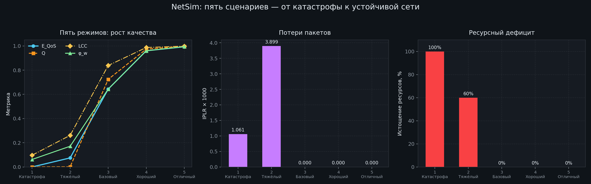

# Пять демонстрационных экспериментов

Набор предназначен для быстрой проверки работоспособности и получения
готовых скриншотов/таблиц для отчёта. Все пять режимов используют одну
топологию **ER G(50, 0,10)** и один seed 42, поэтому меняются только
нагрузка, атаки, ресурсы и ёмкости. Это позволяет увидеть монотонную
деградацию/восстановление, а не случайный разброс между топологиями.

## 1. Запуск

Один файл:

```text
run_showcase.cmd
```

или PowerShell:

```powershell
.\scripts\run_showcase.ps1
# без скриншотов:
.\scripts\run_showcase.ps1 -NoScreenshots
```

Что создаётся:

```text
results/showcase/01_catastrophe/...   topology_comparison.csv, timeseries, plots
results/showcase/02_severe/...
results/showcase/03_baseline/...
results/showcase/04_good/...
results/showcase/05_excellent/...
results/showcase/showcase_summary.csv
results/showcase/showcase_summary.png
docs/img/showcase_summary.png
docs/img/showcase_01_catastrophe.png ... showcase_05_excellent.png
```

После прогонов выполняется `tests/showcase_check.py`; если пороги не
выполнены, скрипт завершается с ошибкой.

## 2. Параметры режимов

Общее: `N=50`, ER `p=0,10`, `qos_class=1`, `seed=42`, 5 топологий нет —
только ER; `topology` — 10 прогонов, `T=60`, 80 точек; `timeseries` —
1 прогон, 120 точек. Ёмкости и трафик — в таблице.

| # | Режим | λ | R | Слотов | Трафик, Мбит/с | Доступ / ядро | Буфер | Смысл |
|---:|---|---:|---:|---:|---:|---|---:|---|
| 1 | Катастрофа | 5,0 | 10 | 1 | 20 | 100 / 100 Мбит/с | 10 | перегрузка + дефицит ремонта |
| 2 | Тяжёлый | 2,0 | 30 | 1 | 10 | 100 / 500 Мбит/с | 20 | сильная деградация |
| 3 | Базовый | 1,0 | 200 | 3 | 2 | 1 / 10 Гбит/с | 100 | рабочий режим |
| 4 | Хороший | 0,2 | 500 | 5 | 1 | 1 / 10 Гбит/с | 300 | запас по ресурсам |
| 5 | Отличный | 0,02 | 2000 | 10 | 0,5 | 10 / 40 Гбит/с | 1000 | атаки почти не влияют |

## 3. Результаты (seed 42)

| # | Режим | E_QoS | Q | LCC | φ_w | IPTD, мс | IPLR | Истощение |
|---:|---|---:|---:|---:|---:|---:|---:|---:|
| 1 | Катастрофа | 0,000 | 0,000 | 0,097 | 0,062 | 0,17 | 1,061·10⁻³ | 100 % |
| 2 | Тяжёлый | 0,075 | 0,001 | 0,261 | 0,171 | 1,31 | 3,899·10⁻³ | 60 % |
| 3 | Базовый | 0,643 | 0,724 | 0,838 | 0,643 | 6,07 | 0 | 0 % |
| 4 | Хороший | 0,960 | 0,974 | 0,987 | 0,960 | 5,05 | 0 | 0 % |
| 5 | Отличный | 0,993 | 0,997 | 0,998 | 0,995 | 4,95 | 0 | 0 % |

Интерпретация:

- **1 — катастрофа:** E_QoS = 0, Q = 0, LCC 0,097; IPLR превышает
  порог класса 1, ресурсы исчерпаны на 100 %. Сеть не выполняет SLA.
- **2 — тяжёлый:** E_QoS 0,075, Q 0,001; IPLR 3,9·10⁻³; 60 % прогонов
  без ресурсов. Видна деградация, но часть пар ещё проходит.
- **3 — базовый:** E_QoS 0,643, Q 0,724, LCC 0,838; потерь нет,
  истощения нет. Это «рабочая» середина.
- **4 — хороший:** E_QoS 0,960, Q 0,974, LCC 0,987; ресурсы не
  истощаются, потери нулевые.
- **5 — отличный:** E_QoS 0,993, Q 0,997, LCC 0,998; λ=0,02, но
  E_QoS почти не отличается от стадии 4 — атаки почти не влияют.

## 4. Пороговые проверки

`tests/showcase_check.py` проверяет:

- `E_QoS` монотонно не убывает (допуск 0,02);
- стадия 1: `E_QoS ≤ 0,01`, `Q ≤ 0,01`, `LCC ≤ 0,30`,
  `φ_w ≤ 0,20`, `IPLR ≥ 10⁻³`, истощение ≥ 90 %;
- стадия 2: `E_QoS ≤ 0,15`, `IPLR ≥ 10⁻³`;
- стадия 3: `0,30 ≤ E_QoS ≤ 0,80`;
- стадия 4: `E_QoS ≥ 0,85`;
- стадия 5: `E_QoS ≥ 0,97`, `Q ≥ 0,95`, `LCC ≥ 0,95`,
  `φ_w ≥ 0,95`, `IPLR ≤ 10⁻⁶`, истощение = 0;
- `E_QoS(5) − E_QoS(4) ≤ 0,10` — атаки почти не меняют картину.

При нарушении выводится `SHOWCASE_FAIL` и конкретные причины; при
успехе — `SHOWCASE_OK`.

## 5. Скриншоты

Сводный график:



Отдельные окна «Динамика» (1921×1112):

- [1. Катастрофа](img/showcase_01_catastrophe.png)
- [2. Тяжёлый](img/showcase_02_severe.png)
- [3. Базовый](img/showcase_03_baseline.png)
- [4. Хороший](img/showcase_04_good.png)
- [5. Отличный](img/showcase_05_excellent.png)

Скриншоты делаются `run_gui.py --open-run ... --tab "Динамика" --screenshot ...`
и показывают реальные CSV-данные соответствующего режима, а не
нарисованные вручную значения.

## 6. Насколько это «реальная система»

ER-граф — абстрактная однородная случайная сеть, а не калиброванная
копия конкретной инфраструктуры. Поэтому пять режимов — это
**демонстрационные профили нагрузки**, а не прогноз для конкретной
организации. Они полезны для:

- проверки, что модель реагирует на перегрузку, атаки и ресурсы;
- сравнения относительных режимов;
- получения воспроизводимых скриншотов и таблиц.

Для прикладного вывода нужны реальные N, p, ёмкости, трафик, SLA и
параметры ремонта; они задаются в GUI/INI.

## 7. Ограничения

- IPER/IPRR не моделируются; проверяются IPTD/IPDV/IPLR.
- Класс QoS фиксирован (здесь класс 1); переходов класса нет.
- Атакуются только узлы; отказов рёбер нет.
- Нет node-link визуализации графа: скриншоты показывают динамику
  метрик, а не топологию.
- `access_capacity` для ER/BA назначается по степеням; в этих прогонах
  используется ER.
